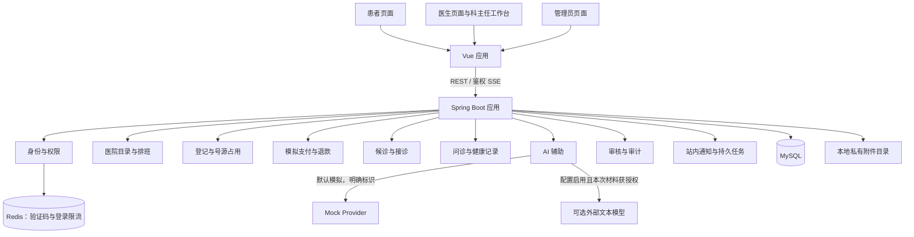
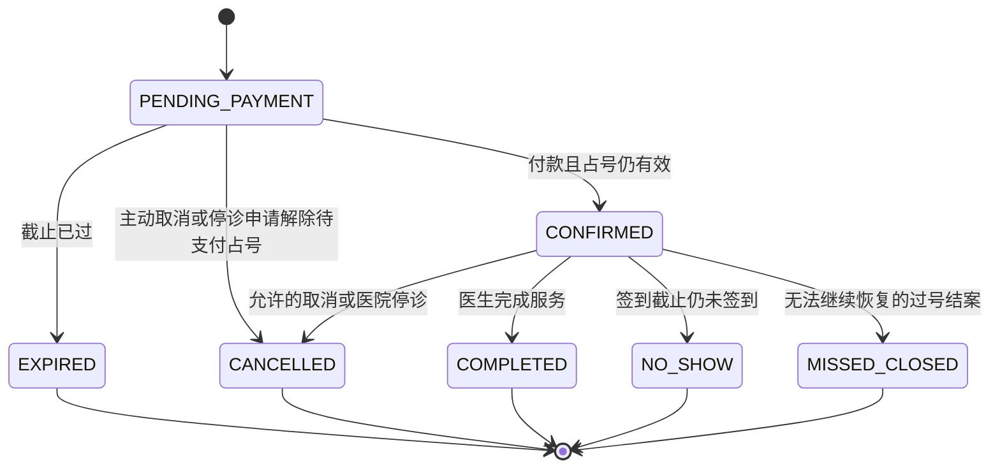
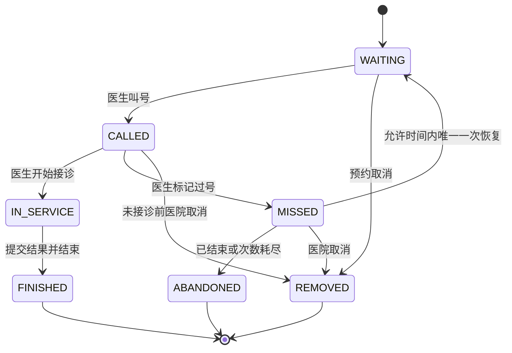
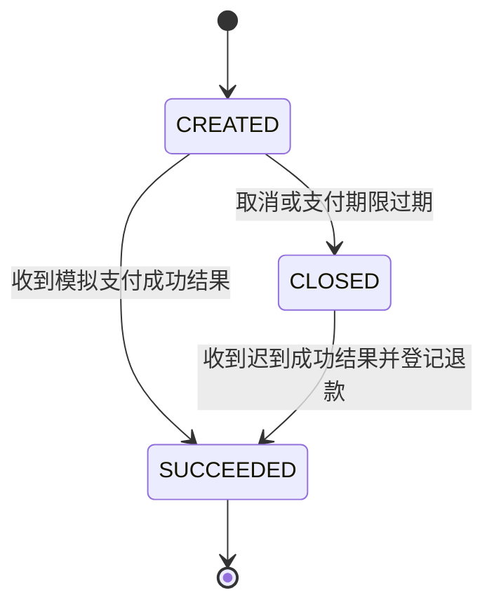
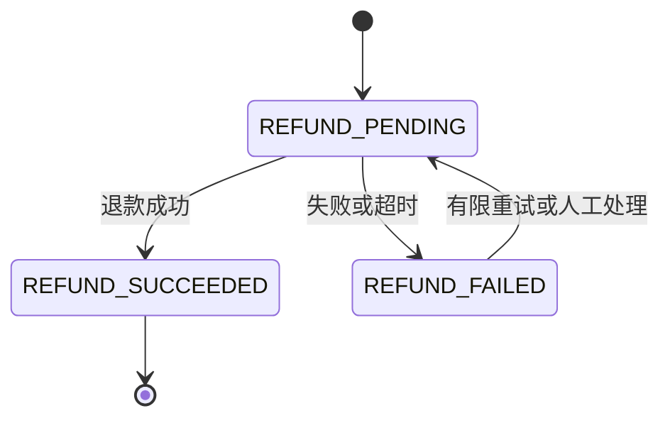
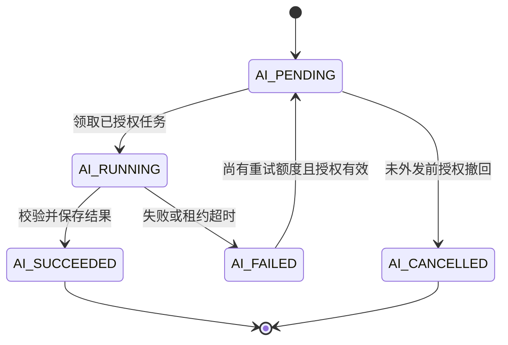
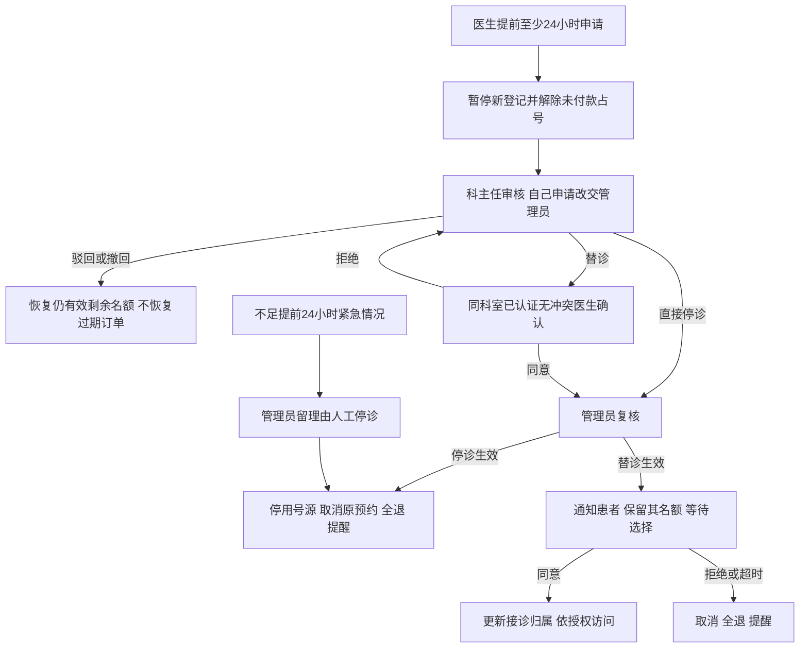

# 智能医疗问诊预约系统架构草案

状态：待用户整体确认。业务依据为 Q1–Q66 及后续 R1/R2（Redis、登录图形验证码）修订；本文将已确认规则整理为可实现的模块、数据和流程方案，表结构、枚举及技术默认值属于本次提案。当前不编写业务代码。

阅读入口：[当前 MVP](current-mvp.md)、[接诊规则](reception-rules.md)、[技术基础](technical-foundation.md)、[术语表](../../GLOSSARY.md)。冲突时以较后轮次的用户确认规则为准，早期 ADR 的替代说明应一并阅读。

## 1. 架构形态

单医院、三端、一个 Vue 应用、一个 Spring Boot 模块化单体、MySQL、Redis 和私有附件目录。Redis 用于登录验证码和短期限流，业务持久状态仍在 MySQL。科主任是医生的科室权限，不增加第四端。模块是业务包，不是独立服务。



以下实现默认值随本草案一起审阅：Java 21、Spring Boot 3 系列、Spring Security、Spring Data Redis、Vue 3 + TypeScript + Vite + Vue Router + Pinia、MySQL 8 系列、Flyway。初始化时再选择兼容且仍维护的补丁版本，不把本文当成已验证依赖锁。数据库访问先用 MyBatis，事务由 Spring 管理；首版引入 Redis，不引入微服务或消息中间件。

## 2. 模块职责与数据所有权

| Module | 拥有的业务数据 | 对外 Interface 示例 |
| --- | --- | --- |
| identity | 账户、角色、患者资料、医生资质、刷新会话；Redis 中短期验证码和登录限流 | 生成验证码、验证码与密码登录、注册、审核资质、检查权限 |
| catalog | 科室、医生科室归属、主任任命、医院信息、排班、号源目录、停诊替诊申请 | 发布出诊、查询有效排班、申请停诊、审批方案 |
| booking | 预约登记、临时占号、患者半天占用、凭证、患者替诊选择 | 提交登记、确认付款后的预约、取消、接受替诊 |
| billing | 支付订单、支付结果、退款及重试记录 | 创建模拟付款、确认结果、申请全额退款 |
| reception | 签到、候诊条目、叫号、过号恢复、接诊过程 | 签到、叫下一位、标记过号、恢复排队、结束接诊 |
| clinical | 症状版本、问诊消息、医生结果、更正、健康档案、共享授权、医疗附件归属 | 提交诊前材料、发送消息、提交结果、追加更正、共享档案 |
| ai | 预问诊会话、外发授权、AI 任务引用、结果版本、调用元数据 | 普通咨询、生成已授权文本摘要、获取可用科室医生建议 |
| governance | 内容审核、受限展示标记、管理员医疗访问理由、操作/访问审计 | 申请审核访问、标记问题、查询授权范围内日志 |
| delivery | 站内消息、持久任务、事件待发送记录 | 记录通知、领取任务、补齐事件、标记已读 |

文件存储、时钟、支付 Provider、AI Provider 是内部 Adapter 的可替换位置，不为每张表创造一层通用接口。主要业务 Interface 接收业务命令并返回完整结果，不能要求 Vue 依次“改表、减库存、建队列”才能正确完成一次操作。

模块不能直接调用别的模块 Mapper 更新其表。跨模块业务由少量应用流程协调，调用各模块 Interface；单体内可以参与同一个 MySQL 事务。外部网络调用在事务之外执行。前端和三端 Controller 共用同一业务入口，不能复制三套登记/退款逻辑。

## 3. 核心数据模型提案

| 关系/数据组 | 关键约束与快照 |
| --- | --- |
| account → role / patient_profile / doctor_profile | 统一账户多角色；首版成年本人；演示核验明确标识 |
| department → doctor_assignment / head_assignment | 医生一个科室；科主任权限限定科室，由管理员授予 |
| clinic_session_template → schedule | 固定上午/下午；排班保存日期、时区、具体起止时间、服务方式、原/当前医生、容量、费用快照，未来模板修改不追改旧排班 |
| schedule → slot | 一个门诊排班多个名额；slot 是容量单元，不是半小时段 |
| appointment → schedule / slot / patient | 记录来源 ADVANCE/WALK_IN、ONLINE/OFFLINE、原/当前医生、就诊半天、金额和截止快照 |
| slot_occupancy / patient_session_guard | 一个有效 slot 占用；一个患者同日期同半天一个有效登记，跨医生、跨线上线下检查 |
| appointment → payment_order → refund | 金额用最小货币单位整数，结果幂等；付款和退款不覆盖预约生命周期 |
| appointment → substitution_choice | 同意/拒绝/超时及截止时间，原订单保留，不静默变更患者的医生选择 |
| appointment → queue_entry / encounter | 每单最多一个队列条目和一次主接诊；保留签到时间、恢复时间、恢复次数、当前顺序与审计事件 |
| appointment → consultation → material_revision / message / result / correction | 一单一个主问诊；原材料、AI 结果、医生结果分别保存；关闭后只读，更正追加 |
| health_record → sharing_grant | 按预约与患者选择授权，不把全部历史档案默认交医生 |
| attachment_metadata → storage_key | JPEG/PNG/PDF；实际格式、大小、上传者、归属和鉴权；不公开物理路径 |
| ai_consent → material_revision → ai_result | 授权绑定提供方/用途/内容范围；结果关联材料、模型与提示版本；材料变化使旧摘要过时 |
| persistent_task / notification / event_delivery | 任务租约、尝试次数、下一次时间、业务幂等标识；事件可补齐，通知已读另记 |
| audit_event / review_case | 操作者、对象、理由、结果、时间；普通日志不含医疗正文、令牌或模型密钥 |

患者半天限制按医院当地日期 + AM/PM 计算，不能用不同排班 ID 绕过。占用记录表达当前有效登记；取消或占号过期解除约束，历史订单仍在。已开始/已签到/过号不因短暂断线释放名额。

## 4. 时间与候诊规则

| 事件 | 上午 | 下午 |
| --- | --- | --- |
| 出诊区间 | [08:00,12:00) | [14:00,18:00) |
| 首次签到 | [07:30,11:45) | [13:30,17:45) |
| 提前预约停止新增 | 08:00 起 | 14:00 起 |
| 现场停止新增、停止首次签到 | 11:45 起 | 17:45 起 |
| 过号恢复停止 | 12:00 起 | 18:00 起 |

医院时区 Asia/Shanghai，后端统一校验，前端按钮只作展示。允许提前签到不代表提前开诊；本草案提议叫号/开始接诊不早于门诊开始，提前签到先等候。正常候诊或已经接诊的可因医生延迟继续服务；过号恢复不跟着延长。

每个医生排班自己的候诊队列，不做全院混排。待叫号按三组：提前预约 > 现场挂号 > 恢复排队；同组按有效入队序号，序号在数据库串行分配以消除同毫秒歧义。已叫号/接诊从待排序集合移出，不受后来签到打断。每名医生同一时刻只允许一个叫号或接诊中的患者；叫号后由医生明确开始接诊或标记过号。

过号恢复的 Interface 同时验证订单归属、MISSED 状态、门诊尚未结束、已恢复次数为 0。一次成功恢复原子更新次数、恢复入队序号和状态；失败不耗次数，相同请求重试不重复更新。再次过号无第二次恢复。时段结束按钮禁用并提示“本次门诊时段已经结束，无法恢复排队”，此原因不退款；医院原因停诊仍按停诊退款处理。

## 5. 状态图提案

这些状态名称是实现提案，下面每个图是独立状态机，不能混成一个订单状态字段。终态不通过改回旧状态来“恢复”，复诊创建新预约；受理人工更正采用追加记录。

### 预约登记



CONFIRMED 期间的签到/候诊/接诊由队列与接诊状态判断。替诊待确认是独立选择和访问门禁；此时禁止签到和接诊，选择超时或拒绝才取消预约。过号结案与未签到爽约分别记录原因，不混淆患者是否曾签到。

### 候诊与接诊



首次签到创建 WAITING；重复签到不重新排号。IN_SERVICE 不能被普通取消或定时任务切断，紧急医疗处置由管理员和医生留痕处理，不自动重写已形成医疗结果。ABANDONED 对应过号结案而非接诊完成。

### 支付与退款



支付 SUCCEEDED 是付款事实，不保证预约成立；处理时重新校验占号、停诊状态、患者半天限制。CLOSED 后迟到的成功付款只记资金事实并申请全额模拟退款，不复活预约。



退款按原付款幂等，不能重复退或超过实付金额。开始前取消、停诊、拒绝/超时未接受替诊、迟到付款按规则全退；未签到爽约和已接诊退款人工处理，过号未恢复为明确不退场景。

### AI 任务



AI_FAILED 耗尽额度后保留失败状态，明确不可用，不静默 mock。普通任务租约恢复不能把旧已失败结果覆盖为成功；使用任务尝试标识隔离迟到响应。结果成功但材料更新时标为过时，不删除历史。撤回授权不能收回已发生的外发，需要明确提示；未发送的任务应停止。

## 6. 关键事务与并发

| 操作 | 必须一起保证的条件 | 异步工作 |
| --- | --- | --- |
| 提交登记 | 检查售号截止/排班开放，抢占 slot 和患者半天 guard，保存订单、金额、有效期与请求幂等结果 | 支付模拟交互不占数据库锁 |
| 处理付款 | 结果幂等，检查占用、期限、停诊；有效则确认，无效则登记退款任务 | 通知、退款 Provider 调用 |
| 取消/停诊 | 对应订单与号源同事务更新；停诊号源停用而非重新售卖；退款意图和任务入库 | 退款、消息发送与重试 |
| 签到/恢复 | 归属与状态、时间、唯一队列、次数、队列序号同事务校验 | 叫号/SSE 事件发送 |
| 叫号/接诊 | 锁定当前医生队列并检查活动接诊，选下一位与更新状态原子完成 | 推送，断线可查询 |
| 结束接诊 | 医生有权限，结果版本、接诊结束、预约完成和诊室只读一并落库 | 提醒、审计投递 |
| 共享撤回/替诊接受 | 授权、当前接诊医生和后续下载/订阅权限使用同一事实来源 | 连接撤权/失效事件 |

先为患者半天 guard 建稳定唯一键，再按固定顺序获取需要的排班/slot 锁；冲突通过数据库约束及有限重试返回业务结果，不抛裸 SQL 错误。占号超时即失效，扫描延迟不得续命；复用过期占号时原订单与付款校验也须保持一致。

停诊与替诊复核锁定涉及医生的日期/半天排班，重验资质、科室、冲突、申请版本和患者影响清单。方案变化不能沿用旧替诊同意；科主任自己申请回避，管理员复核不直接视为替诊医生或患者已同意。方案生效后的未占用号源可由当前有效医生继续发布，已有订单按患者选择处理；该处理为草案提议，接受方案前病历不转授。

## 7. 停诊审批与替诊分支



确认截止取通知后 2 小时与开诊前 2 小时较早值；复核已不足提前 2 小时转人工紧急处理，不自动将未回复当同意。审批尚未完成不自动停诊，提醒管理员。首版无需通用审批引擎，使用专门的停诊/替诊动作和审计记录。

## 8. AI 路径与外发权限

普通咨询优先使用本地医院信息和有限主题回答，不把任意自由输入先发给外部分类器。发现个人症状/报告或不能确定是否普通咨询时，给本地提示、转预问诊授权选择；普通咨询从不自动拼接档案。主观排名、诊断处方越界拒答；紧急/自伤求助提供安全提示和人工指引。

预问诊授权绑定提供方、用途、材料版本与范围，执行前再次校验；初次提交已授权文本自动生成摘要，文本变化后标过时、手动生成新版本。医生不能代替患者扩张外发授权。外部模型响应需结构校验，科室/医生 ID 与有效排班来自本地查询和再次过滤，模型不能执行挂号、调用任意工具、决定权限或签发处方。

建议默认外部 AI 请求总超时 30 秒、总尝试最多 3 次（含首次），只对超时/限流/临时服务故障做退避重试；鉴权错误、拒绝或格式问题不无休止重试。具体运行参数属于本次技术提案。失败显示不可用，患者继续自行挂号，医生继续接诊。默认模拟模式明确显示，真实失败不自动切成模拟。

首版只分析文本；图片、PDF 供医生查看，语音/OCR 接口位置保留但不创建假成功任务。AI 内容是辅助结果，不能覆盖患者原文或医生结论；调用日志只含必要元数据，错误信息做清洗，不泄露正文和密钥。

## 9. 权限与内容治理

| 操作者 | 允许范围 | 不由角色自动获得 |
| --- | --- | --- |
| 患者 | 本人登记、付款、签到、一次恢复、资料和共享选择 | 别人的订单/病历，不通过改 URL 越权 |
| 当前医生 | 被分配且有服务关系的预约及患者授权材料；提交结果/追加更正 | 全部患者历史、替诊未接受者资料 |
| 科主任 | 所属科室停诊审批、替诊选择 | 默认全科病历查看，自审停诊 |
| 管理员 | 用户、目录、排班、订单、模拟例外处置 | 默认医疗正文或改写医生结论 |
| 医疗审核权限 | 专门审核操作、理由、审计、问题限制展示 | 日常任意搜索全量病历 |

权限判断每个后端读写入口执行，下载和 SSE 也执行。短期 JWT 加可撤销 refresh 会话，角色/资质变化按服务器当前事实校验，不完全相信旧令牌中的角色。建议浏览器 access token 仅内存保存，refresh token 用 HttpOnly Cookie；Cookie 操作配置 CSRF 防护和合适 SameSite，Linux HTTPS 部署设置 Secure。鉴权 SSE 采用可带 Authorization 的 fetch 流，禁止把 token 放查询 URL。

三端账号密码登录增加实际图形验证码：先获取绑定浏览器的挑战，在 Redis 原子消费验证，再核验密码；缺失/错码/过期/刷新前旧码/复用均拒绝。验证码失败不执行密码校验，Redis 故障不放行新登录。刷新会话仍保存在 MySQL，Redis 不承担号源、排队或持久任务正确性。图形码不同于演示短信/邮箱验证码，详见 [登录与 Redis](login-security.md) 和 [ADR-0014](../adr/0014-redis-login-image-captcha.md)。

正常回复不等审核通过。审核仅限制可见范围，不删原医疗记录；结束后更正追加作者/原因/时间。患者撤回共享限制未来访问，不能抹去已形成医疗记录。医生结束后保留什么只读权限：本草案建议限本人已完成接诊的必要记录与审计，不继续访问被撤回的独立健康档案；真实医疗保存/访问策略上线前重审。

## 10. 部署与项目结构提案

```text
frontend/                 Vue 单项目，按患者/医生/管理路由组织
backend/                  Spring Boot 单项目
  src/main/java/.../
    identity/ catalog/ booking/ billing/ reception/
    clinical/ ai/ governance/ delivery/
    application/          跨模块流程协调
    infrastructure/       存储、Provider、任务与安全适配
  src/main/resources/db/migration/
docs/design/              当前范围、架构与验收路径
docs/adr/                 架构取舍
```

单台 Linux：反向代理提供静态前端、HTTPS、REST/SSE 转发，Spring Boot 单进程，MySQL、Redis 在私有网络，MySQL 与私有文件目录在持久卷。SSE 关闭代理缓冲并配置超时；静态前端不映射私有目录。Windows 配置 MySQL/Redis 本地连接；Linux 通过环境配置注入密钥，不进入 Git。Redis 不暴露公网。

持久任务、通知、号源、恢复次数和刷新会话在 MySQL；Redis 保存可丢失重建的验证码及限流，不靠其过期事件释放号源。Redis 故障影响新登录，不取消既有预约。密钥、依赖锁和初始化管理账户在实施阶段处理，不提供对外共享默认管理密码。数据库及附件联合备份；重置演示数据明确操作并审计，不自动清空病历。

## 11. 分期实施与验收

每步都做端到端可演示结果，而非先做完所有表、所有页面再联调。每次变更更新必要测试、验证后提交 Git commit；不自动 push。

| 阶段 | 可演示交付 | 必须验证的场景 |
| --- | --- | --- |
| 1 基础身份目录 | 三端图形验证码登录、Redis、医生认证、科室主任、医院信息、上午下午排班 | 验证码过期/刷新/复用/并发/限流、Redis 故障不放行、后端越权、医生未认证不可发布、排班冲突 |
| 2 登记支付 | 提前/现场登记、半天限单、占号、模拟付款、凭证、取消退款 | 同号竞争、跨医生重复占号、重复请求、超时/停诊后付款全退、金额不追改 |
| 3 候诊接诊 | 签到、三组叫号、一次恢复、线上诊室、线下面诊结果 | 时间边界、并发恢复一次、叫号不重复、医生延迟不记爽约、结束后只读 |
| 4 档案与文本 AI | 附件共享、普通咨询、授权预问诊、文本摘要版本 | 未授权不外发、旧摘要标过时、失败不阻断、不静默模拟、附件越权/格式限制 |
| 5 停诊治理 | 科主任/替诊/管理员/患者选择，提醒和事后审核 | 自审回避、拒绝回退、复核冲突、暂停待支付、患者未接受不可看病历、超时退款 |
| 6 部署验收 | 单机 Linux、移动患者页、虚构数据、日志和备份恢复说明 | 重启恢复任务、重复付款不重退、SSE 断线补齐、私有附件不公开、核心双业务线全流程 |

后续迭代独立加入语音、图片/OCR 分析、真实支付适配、院内检查药房模拟、评价统计和更丰富的知识维护。首版不假装完成真实实名、医疗上线合规或模型临床准确性验证。

## 12. 整体确认内容

业务 Q1–Q66 和 R1/R2 修订已确认；待确认的是本草案整合，包括模块/数据所有权、状态枚举、事务方案、技术默认值、实施顺序与验收。额外实现细节（如开诊后叫号、单医生一次一个接诊、任务重试和验证码运行参数、替诊剩余名额发布、医生只读记录范围）随整体审阅确认，不冒充先前已回答的业务事实。

确认后将文档标为已确认并固化相关设计记录。开始业务代码开发需要后续明确安排，不因确认架构而自动搭建项目、调用真实 AI 或发送数据。
