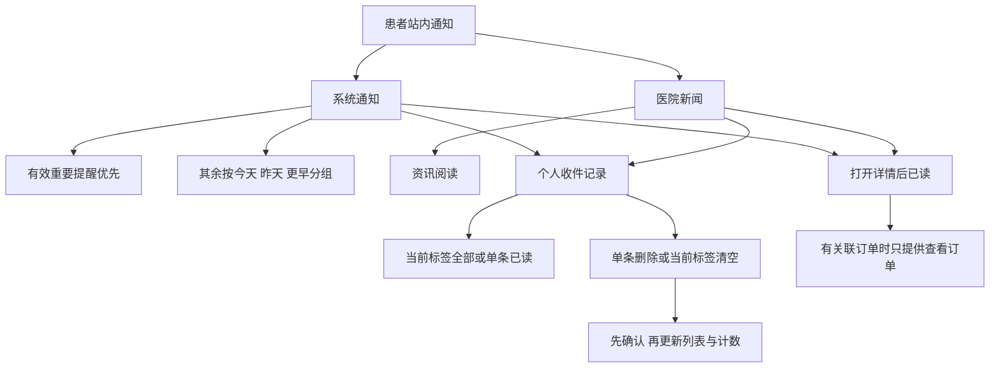

# 患者端站内通知原型设计

状态：Q1–Q28 逐项决定已确认，等待用户确认本汇总后实施。本文只记录设计，页面尚未实现。关联总需求 #1；延续 [三端规格](three-end-requirements.md) 的双标签、个人业务通知和医院新闻边界。验收计划见 [通知原型验收记录](../acceptance/issue-1-patient-notifications-prototype.md)。

## 范围与设计树

本轮继续患者端 A 版原型工作区，保留可收缩侧栏、顶部导航、临时工作区标签、全局 AI 助手和立即挂号入口。页面使用固定虚构数据与内存状态，刷新恢复初始演示数据；不接真实通知、新闻管理或 SSE 接口。正式端已有通知能力作为后续接入基础，不将原型当作生产通知中心。

现状核对：原型通知入口目前打开简单弹窗，正式通知接口已有列表、未读数、单条已读和实时流；删除、清空、全部已读及新闻个人隐藏尚需后续接口支持。本原型确认的阅读流程为先打开详情，再通过“查看订单”定位业务，细化原始规格中的通知跳转描述。

## 页面与阅读体验

1. 页面标题为“站内通知”，内容区沿用现有浅蓝与青绿配色。主标签为“系统通知 / 医院新闻”，默认系统通知。
2. 两个标签均提供“全部 / 未读”筛选，默认全部。未读条目用圆点和加粗标题表示。
3. 顶部显示当前标签的未读数量，工具栏提供“全部标为已读”和“清空”；条目提供单条删除入口。
4. 桌面展示通知列表，点击条目打开右侧详情抽屉；手机顶部保留双标签与筛选栏，详情采用全屏弹层，适配 375px 且无横向溢出。
5. 详情统一展示标题、来源、发布时间、完整正文，以及适用时的关联业务信息。新闻可展示封面或附件（若有），不要求为原型引入文件上传能力。
6. 打开并成功展示详情后标记已读，单纯进入列表不批量已读。支持单条“标为已读”和当前标签“全部标为已读”。
7. 系统通知与医院新闻各自维护阅读状态；顶部铃铛与侧栏红点只统计未删除的未读系统通知，新闻不计入全局红点。

## 内容、优先级与跳转

系统通知包含挂号成功、缴费、签到、叫号、过号、停诊、替诊、取消、退款结果和账户安全提醒。不混入 AI 对话、医生问诊消息或营销推广。

医院新闻包含医院公告、门诊调整、健康活动等公开资讯；点击条目在统一详情中阅读，不显示业务操作按钮。

系统通知分为高优先级和普通两级。有效的停诊、替诊、退款失败、临近签到等高优先级通知展示于顶部“重要提醒”区，区内按时间倒序；其余通知按“今天 / 昨天 / 更早”分组，组内按时间倒序。每条仅出现一次。已读不解除重要性；提醒过期或关联事项已结束后回归时间分组。历史通知正文仍表达当时的事实，订单页面展示当前业务状态。

最终 Q26 覆盖早先 Q14 的多按钮方案：**关联订单的通知只保留“查看订单”一个业务按钮**，定位到对应挂号单；无关联订单的通知和医院新闻不显示此按钮。通知页不提供重新挂号、取消、支付、签到或接受替诊的操作入口。

- 停诊通知说明对应订单因停诊自动取消，并分别说明实际退款状态，不把取消直接等同于退款成功。
- 替诊通知说明医生已经变更、预约继续有效，患者无需确认接受；需要取消时在订单页按现有规则操作。
- 开启通知详情不改变预约、退款、候诊、问诊或医疗记录。

## 删除与清空

删除只影响当前患者的通知收件记录，保留订单、退款、停诊、替诊、审计与医院新闻原文。删除新闻也只隐藏当前患者所见的该条资讯，不影响其他患者。

| 操作 | 作用范围 | 确认与反馈 |
| --- | --- | --- |
| 单条删除 | 指定条目，包括高优先级条目 | “确认删除这条通知？”；取消 / 确认删除；默认焦点为取消 |
| 清空 | 当前标签下全部未删除条目，包括已读和未读；不受当前筛选影响 | “确认清空当前标签下的 N 条通知？”；明确说明包含已读与未读；取消 / 确认清空；默认焦点为取消 |
| 全部标为已读 | 当前标签下全部未读条目，不跨标签 | 立即更新当前标签阅读状态及相关系统通知计数 |

高优先级通知删除时额外提示“删除后仍可在我的挂号查看相关业务状态”。取消确认不改变任何条目。删除或清空成功显示短暂反馈，同步列表、未读数、顶部红点与侧栏红点。从详情删除当前条目后关闭详情；清空造成当前详情失效时也返回列表。

## 路由、入口与异常状态

原型路由为 `/prototype/patient-home/notifications?tab=system`；医院新闻使用 `tab=news`。`notice` 参数定位指定条目并打开详情，依据条目所属类别选中标签。顶部导航、侧栏、铃铛和首页医院动态统一进入本页面，能带具体条目的入口保留该定位。

页面提供加载中、加载失败、暂无通知、暂无未读和更新提示。失败时提供“重新加载”，保留已展示内容。固定演示数据至少包含未读停诊、未读替诊、待签到、挂号成功、退款结果、已读医院公告、门诊调整新闻，以及空态和失败态入口。

已删除或不存在的详情链接显示“该通知已删除或暂不可用”，允许返回对应列表，不凭链接恢复已删除条目。已失效的业务提醒仍可查看历史正文，“查看订单”以订单当前状态为准。

## 实施验收边界

页面实现前在 [验收记录](../acceptance/issue-1-patient-notifications-prototype.md) 中按公开交互补齐浏览器用例；所有项目目前均为待实现、待验证。完整门禁继续使用 `scripts/verify.ps1`，通过后按仓库要求创建对应提交。本设计阶段只更新文档、术语和文档检查，不将页面验收记为通过。
